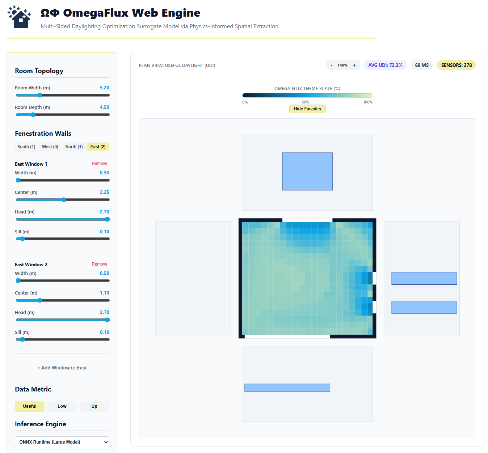
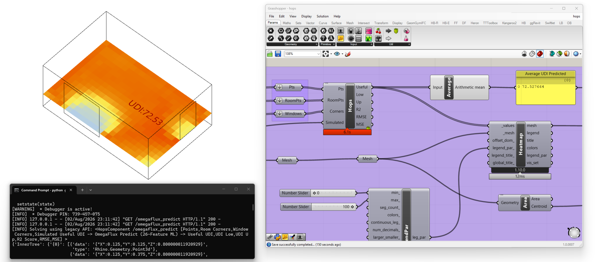

<div align="center">


# OmegaFlux

**Daylight prediction without neural networks**

*Coordinate-free radiometric features for per-sensor machine learning
and their transferability across building form.*

***Tabular Data is All You Need***

[](#citation)
[](LICENSE)
[](LICENSE-DATA)
[](pyproject.toml)

</div>

---

A per-sensor surrogate model for annual **Useful Daylight Illuminance**. Each grid point on a floor
plate is described by 26 dimensionless radiometric quantities computed in closed form from the
geometry visible at that point — principally the solid angle subtended by visible apertures,
weighted by the sky each admits. Because the descriptor count does not depend on how many apertures
a room has or where they sit, a fixed-width tabular model can be applied to a variable-topology
geometric problem, which is the representational obstacle that has pushed comparable work toward
convolutional and generative architectures.

The model is a pair of gradient-boosted tree ensembles. **There is no neural network at any stage.**

| | |
|---|---|
| Training population | 6,749 rooms, 3,266,627 grid points |
| Ground truth | Radiance annual CBDM via Honeybee, Warsaw (52.17° N) |
| Accuracy, unseen rooms | R² = 0.986, RMSE 2.15 pp of annual occupied hours |
| Unseen aperture count | R² = 0.977 |
| Unseen plan orientation | R² = 0.966 |
| Unseen plan topology | R² = 0.716 (26 descriptors) / 0.869 (12 descriptors) |
| Speed | 0.48 ms per grid point, ~200× a 45 s Radiance run |

---

## What is in this repository

```text
omegaflux/
├── data/
│   ├── raw/                  simulation output, one file per stratum
│   └── processed/            per-grid-point descriptor table (generated)
├── apps/
│   ├── web/                  browser application, ONNX runtime, no server
│   ├── hops/                 Grasshopper server via Hops
│   └── grasshopper/          Grasshopper definitions
├── OmegaFlux_Models/                   trained models (see Releases)
├── omegaflux/
│   ├── __init__.py
│   ├── README.md             Module-level documentation
│   ├── generate_doe.py       Generates LHS simulation matrices
│   ├── unzip_data.py         Extracts raw simulation zip files
│   ├── extract_features.py   Stage 1: raw -> per-grid-point table
│   ├── train.py              Stage 2: table -> models + results
│   ├── explain.py            TreeSHAP attribution
│   ├── make_figures.py       Generate figures from artefacts
│   ├── export_onnx.py        Export web-ready ONNX models
│   └── fetch_models.py       Download pre-trained release models
├── setup_env.py              Environment installer
├── main.py                   Pipeline automation runner
└── docs/                     additional information
```

---

## Quick start

```bash
git clone https://github.com/Curiosit/omegaflux.git
cd omegaflux
python -m venv .venv
.venv\Scripts\activate
pip install -e ".[dev]"
```

Verify your installation and local models by running the test script:

```bash
python test_predict.py
```

Run the whole study in a fast mode
```python
python main.py --mode fast
```

Predict a floor plate from an existing model:

```python
from omegaflux import predict_room

room    = [(0, 0), (5.0, 0), (5.0, 4.2), (0, 4.2)]      # plan, metres, CCW
windows = [dict(wall=0, centre=2.5, width=1.8, sill=0.9, height=1.5)]

field = predict_room(room, windows, grid=0.25)          # -> x, y, UDI_useful
print(f"{field.mean():.1f}% of occupied hours, mean over {len(field)} points")
```
# Reproduce the whole study from the deposited simulation output:
```
# Optional: Generate LHS sampling matrices
python -m omegaflux.generate_doe

# Core Pipeline
python -m omegaflux.unzip_data           # Extracts data/raw zip files
python -m omegaflux.extract_features     # raw  -> per-grid-point table  (~40 min)
python -m omegaflux.train --mode fast    # table -> models + results     (~3 h) (use --mode full for hyperparameter tuning)
python -m omegaflux.explain              # models -> TreeSHAP attribution
python -m omegaflux.make_figures         # everything -> figures

# Export Models
python -m omegaflux.export_onnx          # json -> web ready onnx models
```
---

## The four stages

**1 · Ground truth.** 6,749 room configurations sampled by Latin Hypercube across six typological
bins — four rectangular fenestration patterns, one rotated, one non-convex L-shaped — simulated in
Radiance through Honeybee. Every room is free-standing: no external obstruction is modelled in any
stratum, so the room's own re-entrant form is the sole source of sky occlusion.

**2 · Representation.** The room is discarded as the unit of analysis. Each grid point becomes one
record described by 26 dimensionless quantities computed analytically from the geometry visible at
that point. Absolute coordinates and bounding dimensions enter only as normalisers. The solid angle
subtended by each aperture is evaluated in closed form by the Van Oosterom–Strackee formula, not by
ray sampling — this is what makes extraction cheap enough to keep the model tabular.

**3 · Learning.** Two XGBoost regressors predict the under- and over-illuminated fractions
separately; the useful fraction follows by closure. Partitioning is by room geometry *before* any
model fitting, so no grid point from a test room influences training — the spatial autocorrelation
between adjacent points at 0.25 m spacing would otherwise inflate reported accuracy substantially.

**4 · Deployment.** The trained pair requires no GPU, no server and no deep-learning runtime.
Three paths are provided: a browser application, a Grasshopper server, and direct use inside an
optimisation loop.


---

## Applications

### Browser

Runs entirely client-side with ONNX Runtime Web. No installation, no server, no data leaves the
machine.

```bash
cd apps/web
npm install
npm run dev
```



### Grasshopper

A local Hops server exposing the model to Grasshopper.

```bash
pip install -e ".[hops]"
python apps/hops/hops_server.py           # then point a Hops component at http://localhost:5000
```

Definitions are in [apps/hops/](apps/hops/) and [apps/grasshopper/](apps/grasshopper/)



---

## Data

Simulation output is deposited under `data/raw/`, one `zip` file per stratum:

| File | Stratum | Rooms | Format |
|---|---|---|---|
| `study-ml-rect.xlsx` | bins A-D, axis-aligned, 1–2 apertures per wall | 4,500 | one row per room |
| `study-ml-rotated.xlsx` | bin E, as A–D at 90°, 180°, 270° | 1,124 | one row per room |
| `study-ml-shapes.csv` | bin F, non-convex, 1–3 apertures on any wall | 1,125 | one row per room |

Each row carries the room geometry, aperture specification, the sensor grid and the annual results
(`raw_UDI_low`, `raw_UDI_up`, and the sDA/ASE/DA aggregates). Bin F is CSV rather than XLSX because
its sensor field exceeds the 32,767-character limit on a spreadsheet cell — see
[data/README.md](data/README.md), which also documents the column schema and a coordinate-truncation
issue that affected an earlier version of that file.

The processed 3.27 M-row descriptor table is regenerated by `extract_features`. The file is roughly 1.5 GB and is **not** committed. 

---

## Models

Trained models are attached to the [latest release](../../releases) rather than committed, since
the pair exceeds GitHub's file-size guidance:

| File | Size | Use |
|---|---|---|
| `omegaflux_xgb_low.joblib` | 7 MB | under-illuminated fraction |
| `omegaflux_xgb_up.joblib` | 18 MB | over-illuminated fraction |
| `omegaflux_low.onnx`, `omegaflux_up.onnx` | 5 / 15 MB | browser deployment |

```bash
# fetch into models/
python -m omegaflux.fetch_models
```


---

## Licence

Code is MIT ([LICENSE](LICENSE)). Data, figures and documentation are CC BY 4.0
([LICENSE-DATA](LICENSE-DATA)). Attribution is required for both.

## Acknowledgements

Simulation uses [Radiance](https://www.radiance-online.org/) through
[Ladybug Tools](https://www.ladybug.tools/). Learning uses
[XGBoost](https://xgboost.readthedocs.io/). Grasshopper integration uses
[Hops](https://developer.rhino3d.com/guides/grasshopper/hops-component/).

Faculty of Architecture, Warsaw University of Technology.
