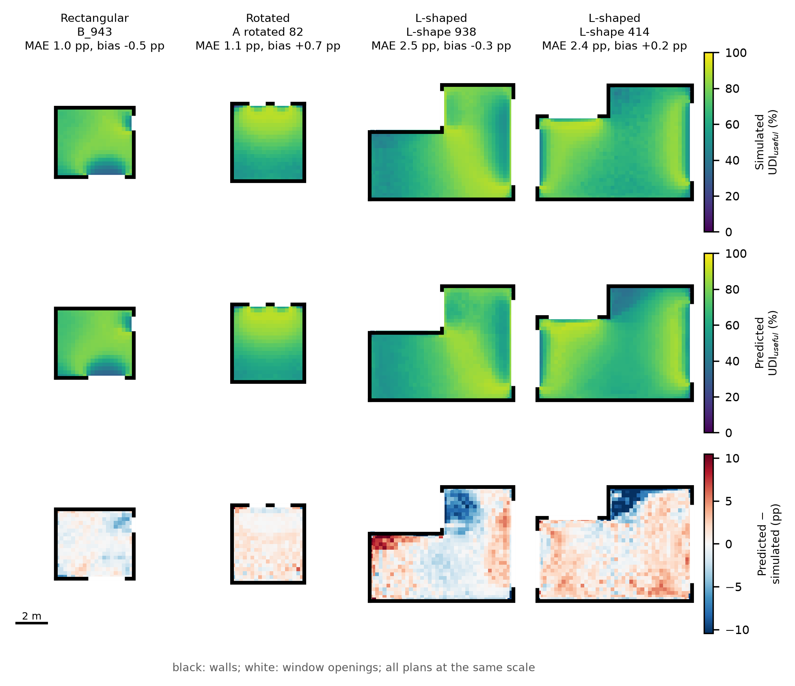

<div align="center">


# OmegaFlux

**Daylight prediction from per-sensor geometric descriptors: descriptor selection for transfer to unseen room shapes**

[](https://curiosit.github.io/OmegaFlux/)
[-lightgrey)](#citation)
[](https://doi.org/10.5281/zenodo.21781259)
[](LICENSE)
[](LICENSE-DATA)
[](pyproject.toml)

</div>

---

A per-sensor surrogate model for annual **Useful Daylight Illuminance** (UDI, 100–3000 lux). Each
grid point is described by geometric descriptors of what it sees through the windows and of where it
is in the room. Contributions of all windows are summed or weighted, so the number of inputs does not
depend on how many windows a room has. Twelve descriptors were selected from 26 candidates; two
gradient-boosted tree models (XGBoost) predict the under- and over-illuminated fractions, and
UDI_useful = 100 − UDI_low − UDI_up.

The repository accompanies the article above and contains the simulation data, the full pipeline,
every experiment reported in the paper, the paper figures, a browser application and a Grasshopper
service.

| | 12 descriptors | 26 descriptors |
|---|---|---|
| Held-out rooms (E1), R² / RMSE | 0.976 / 2.86 pp | 0.986 / 2.17 pp |
| Rectangular → L-shaped rooms (E2), R² | **0.856 ± 0.001** | 0.778 ± 0.035 |
| Unrotated → rotated rooms (E3), R² | 0.952 | 0.968 |
| 1–2 → 3–4 windows (E4), R² | 0.965 | 0.977 |

E2 values are means ± SD over three model seeds. A model on window coordinates reaches R² = −0.05 in
E2. Room rankings are preserved (Spearman ρ of room means 0.99 on held-out rooms, 0.97 on unseen
L-shaped rooms). Extracting descriptors takes about 0.4 ms per grid point and prediction about
0.02 ms, so a room is predicted in well under a second, about 200 times faster than the 45 s
Radiance run.


<em>Simulated (top) and predicted (middle) UDI_useful, and the error (bottom), for four held-out rooms.</em>

**Main finding.** Descriptors of the view through the windows, and of the point's position in the
room, transfer from rectangular to L-shaped rooms. Distances to the nearest window and wall do not:
in a rectangle the nearest window is always in view, so its distance is a good proxy for light, but in
an L-shaped room it can be hidden behind the inner corner. Adding them improves accuracy within
rectangles and lowers it on L-shapes.

**Scope.** One climate (Warsaw, 52.17° N), fixed reflectances and glazing, room height 2.7 m, no
external obstruction. On L-shaped rooms the model overestimates UDI_useful at points that see the
windows through a small solid angle, so it is better suited to comparing variants than to absolute
values in non-convex plans.

---

## What is in this repository

```text
OmegaFlux/
├── data/
│   ├── raw/                  simulation output, one zip per stratum (+ raw/convergence/)
│   ├── processed/            per-grid-point descriptor table (generated, not committed)
│   └── convergence_check/    Radiance convergence check (-ab 5 / 8 / 12), cleaned
├── omegaflux/                the Python package (see omegaflux/README.md)
├── figures/paper/            all figures of the article (see figures/paper/README.md)
├── apps/
│   ├── web/                  browser application, ONNX Runtime Web, no server
│   ├── hops/                 Grasshopper service via Hops
│   └── grasshopper/          Grasshopper definitions
├── docs/REPRODUCE.md         which command produces which table and figure
├── run_*.bat                 the experiment batches used for the article (Windows)
├── main.py                   pipeline runner
├── setup_env.py              environment installer
└── test_predict.py           installation check
```

Trained models are not committed; they are attached to the GitHub release (see [Models](#models)).

---

## Quick start

```bash
git clone https://github.com/Curiosit/OmegaFlux.git
cd OmegaFlux
python -m venv .venv
.venv\Scripts\activate            # Windows; on Linux/macOS: source .venv/bin/activate
pip install -e ".[dev]"
python -m omegaflux.fetch_models  # 12-descriptor models -> OmegaFlux_Models/core
python test_predict.py
```

Predict a floor plate:

```python
from omegaflux import predict_room

room    = [(0, 0), (5.0, 0), (5.0, 4.2), (0, 4.2)]      # plan, metres, counter-clockwise
windows = [dict(wall=0, centre=2.5, width=1.8, sill=0.9, height=1.5)]

field = predict_room(room, windows, grid=0.25)          # -> x, y, UDI_useful
print(f"{field.mean():.1f}% of occupied hours, mean over {len(field)} points")
```

## Reproducing the study

```bash
python -m omegaflux.unzip_data                            # data/raw/*.zip -> data/raw/
python -m omegaflux.extract_features                      # -> data/processed/ (about 40 min)
python -m omegaflux.train --mode full --features core     # 12 descriptors -> OmegaFlux_Models/core
python -m omegaflux.train --mode full --features all      # 26 descriptors -> OmegaFlux_Models/all
python -m omegaflux.make_paper_figures                    # -> figures/paper/
```

`main.py --mode full` runs the same chain for one descriptor set. The seed repeats, selection
paths, ablations, baselines, applicability check and convergence check are separate runs; the
`run_*.bat` files list them, and [docs/REPRODUCE.md](docs/REPRODUCE.md) maps every table and figure
of the article to the command that produces it.

Training options: `--steps tune,cv,topology,baselines,fs,size,shap,figures` runs selected
experiments; `--topology E2,E3,E4` chooses the transfer tests; `--params-from <folder>` reuses tuned
hyperparameters; `--fs-e2-weight 0` scores forward selection on in-distribution accuracy only;
`--feature-list a,b,c` trains on a custom descriptor list; `--model-seed N` changes only the model
fitting (data splits stay fixed); `--target useful` trains one model directly on UDI_useful.

---

## Method in brief

**Data.** 6,749 rooms sampled by Latin Hypercube in six bins: four rectangular window patterns on the
south and east walls (A–D, 4–6 m), the same patterns rotated (E), and L-shaped rooms with one to three
windows on any wall (F, 5–12 m). Annual simulation in Radiance 5.4 through Honeybee 1.10
(daylight-coefficient method, Perez sky, `-ab 5 -ad 5000 -lw 2e-05`), reflectances 0.8 / 0.5 / 0.2,
ground 0.1, glazing transmittance 0.64, occupied hours 8:00–18:00. Sensor grid 0.25 m at 0.8 m.

**Descriptors.** For each grid point and window: solid angle (Van Oosterom–Strackee, two triangles per
window), a visibility weight from a plan sightline to the window centre, and a sky-visibility ratio for
the window. These are combined into 26 window-count-independent candidates (solid angles, orientation,
direct sun from 87 sun positions, distances and room-shape measures). The 12 kept are listed in
`omegaflux/features.py` (`FEATURES_CORE`) and in Table 2 of the article.

**Learning.** Two XGBoost models (UDI_low, UDI_up), depth 6, learning rate 0.15, other parameters by
randomised search; early stopping on 10% of training rooms. All splits are by room, never by sensor.

**Selection.** Greedy forward selection up to 12 descriptors, scored as 0.6 × R² on 254 reserved
L-shaped training rooms (model trained on rectangular rooms) + 0.4 × R² on 15% of the training rooms;
a control path uses the second term only. The test rooms are not used for selection or tuning.

---

## Applications

### Browser

**[▶ curiosit.github.io/OmegaFlux](https://curiosit.github.io/OmegaFlux/)**

Runs entirely client-side with ONNX Runtime Web. No installation, no server, no data leaves the
machine. To run locally:

```bash
cd apps/web
npm install
npm run dev
```


### Grasshopper

A local Hops service exposing the model to Grasshopper:

```bash
pip install -e ".[hops]"
python apps/hops/gh.py            # then point a Hops component at http://localhost:5000
```

Definitions are in [apps/hops/](apps/hops/) and [apps/grasshopper/](apps/grasshopper/).

---

## Data

| File | Bins | Rooms | Format |
|---|---|---|---|
| `data/raw/study-ml-rect.xlsx.zip` | A–D, rectangular | 4,500 | one row per room |
| `data/raw/study-ml-rotated.xlsx.zip` | E, A–D rotated by 90°, 180°, 270° | 1,124 | one row per room |
| `data/raw/study-ml-shapes.csv.zip` | F, L-shaped | 1,125 | one row per room |

Each row holds the room geometry, the windows, the sensor grid and the annual results per grid point
(`raw_UDI_low`, `raw_UDI_up`, plus DA, sDA and ASE). The column schema and the simulation settings are
in [data/README.md](data/README.md). The processed 3.27-million-row descriptor table (about 1.5 GB) is
regenerated by `extract_features` and is not committed.

---

## Models

Trained models are attached to the [GitHub release](../../releases) rather than committed:

| File | Use |
|---|---|
| `omegaflux_xgb_low.json` / `.joblib` | under-illuminated fraction (UDI_low) |
| `omegaflux_xgb_up.json` / `.joblib` | over-illuminated fraction (UDI_up) |
| `omegaflux_low.onnx`, `omegaflux_up.onnx` | browser deployment (copied to the web app as `OmegaFluxLow/Up.onnx` with `--web`) |
| `features.json` | input descriptors, in order |

```bash
python -m omegaflux.fetch_models                       # v1.1.0, 12 descriptors -> OmegaFlux_Models/core
python -m omegaflux.fetch_models --web                 # also update the browser app
python -m omegaflux.fetch_models --tag v1.0.0 --out OmegaFlux_Models/v1.0.0   # original 26-descriptor models
```

Changes between releases are listed in [CHANGELOG.md](CHANGELOG.md).

---

## Citation

If you use the code or data, please cite the archived release and, once published, the article.

> Płoszaj-Mazurek, M. (2026). *OmegaFlux: daylight prediction from per-sensor geometric descriptors*
> (v1.1.0) [Software and data]. Zenodo. https://doi.org/10.5281/zenodo.21781259

> Płoszaj-Mazurek, M. *Daylight prediction from per-sensor geometric descriptors: descriptor
> selection for transfer to unseen room shapes.* Submitted to Journal of Building Engineering.

Citation metadata is in [CITATION.cff](CITATION.cff).

## Licence

Code is MIT ([LICENSE](LICENSE)). Data, figures and documentation are CC BY 4.0
([LICENSE-DATA](LICENSE-DATA)).

## Acknowledgements

Simulation uses [Radiance](https://www.radiance-online.org/) through
[Ladybug Tools](https://www.ladybug.tools/). Learning uses
[XGBoost](https://xgboost.readthedocs.io/). Grasshopper integration uses
[Hops](https://developer.rhino3d.com/guides/grasshopper/hops-component/).

Faculty of Architecture, Warsaw University of Technology.
